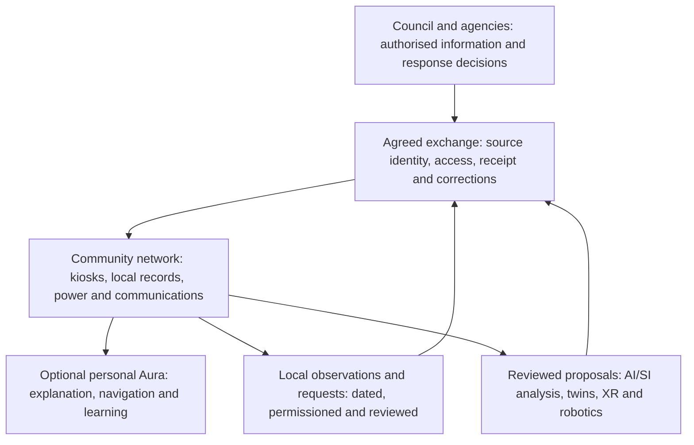

# Council plans, Aura and a stronger island network

[Start here](Home.md) · [Plan crosswalk](Council-plan-crosswalk.md) · [Questions](Question-register.md) · [Professional review](Professional-review.md)

[Guardian IMS and QIT Plus](Guardian-IMS.md) adds public-source research and a proposed partnership path under Luke's scenario of Guardian continuing as Council's contracted system while people with Auras connect through agreed interfaces.

**AI-generated analysis and proposed development path · 21 October 2026.** This component analyses the two Council plans supplied by Luke and checked public publication routes. It supports design, comparison and eventual integration. Council participation, operational agreements and measured improvements will have their own records as they develop.

The opportunity is to turn a plan people can read into dependable capability people can use: a warning that remains understandable when the internet drops, a generator that is connected and ready, a request whose next owner is clear, and recovery support that follows through. Aura of Intelligence could connect these jobs through personal guidance, shared information, artificial intelligence (AI), future superintelligence (SI), extended reality (XR) and robotics. XR includes information added to a view of the world and immersive practice spaces. We can aim for substantially better results and show exactly where they are achieved.

## The two source plans

| Preserved source | Edition and page convention | Publication check on 21 October 2026 |
| --- | --- | --- |
| [Local Disaster Management Plan](../sources/documents/redland-city-local-disaster-management-plan.pdf) · DOC-033 | Version 1.2, December 2025; authority and approval dated 19 December 2025, including post-Alfred updates. 126 PDF pages. Printed p.10 is PDF p.11; this one-page offset continues throughout. | Council's [Strategies and Plans](https://www.redland.qld.gov.au/About-Council/Strategy-Planning-and-Policy/Strategies-and-Plans) links the [December 2025 control copy](https://www.redland.qld.gov.au/files/assets/public/v/3/community-safety-and-health/documents/20251219-local-disaster-management-plan-control-copy.pdf). The supplied copy's internal edition and approval match that publication. |
| [Disaster Recovery Plan](../sources/documents/redland-city-disaster-recovery-plan-2016.pdf) · DOC-034 | 2016 Part 5, with an April 2016 full rewrite recorded on printed p.viii, PDF p.5. 65 PDF pages, usually containing two printed pages per sheet. Its approval statement is undated; the amendment register identifies this edition. | The 2025 management plan still references this baseline at §7.6, printed p.91, PDF p.92. Council's [recovery-plan engagement page](https://yoursay.redland.qld.gov.au/are-you-disaster-prepared-1) says a new plan is being developed and the surveys have closed. Reconfirm the applicable edition when preparing a Council proposal. |

Council also lists two **event-specific Cyclone Alfred recovery plans**, endorsed on 16 July 2025, on its [Redland Recovery page](https://www.redland.qld.gov.au/Business-and-investment/Redland-Recovery). They add event-specific priorities alongside the general baseline. A future comparison should include their relevant actions and the replacement general plan when available.

The [document manifest](../data/document-manifest.json) records the exact supplied bytes, page counts and SHA-256 fingerprints. Those preserved copies remain identifiable as Council updates its sources. Original authorship and rights remain with their source owners. Source instructions describe their own arrangements; the actual user request authorises this analysis and publication.

## Start from the overlap already in the plans

The management plan's community service-provider resilience framework is the clearest starting point: local services can contribute intelligence and resources through relationships with the Human and Social Recovery Group. Its continuous-improvement section also encourages research, innovation and learning across agencies, business and communities. **M §§3.5.1 and 1.1.9: printed pp.57 and 17, PDF pp.58 and 18.** [See the source crosswalk](Council-plan-crosswalk.md).

**Ready S.E.T. Co-op**, fully **Ready Sustainable Employment and Training Cooperative**, is the proposed intermediary for the kiosk, Cultural Intelligence Node and media network. Its prospective contribution could cover everyday information, accessible assistance pathways, local learning, equipment stewardship and recovery coordination. Its formation, community mandate, service relationships, staffing and continuing resources remain milestones to develop.

The Local Disaster Management Group (LDMG) is the formal multi-agency group. The Local Disaster Coordinator (LDC) coordinates disaster operations, and the Local Disaster Coordination Centre (LDCC) supports that work. These are distinct from the proposed Ready S.E.T. Co-op councils, teams and committees. Their work can connect through agreed people, records and interfaces. Luke drives the project as initiator and brings proposals forward; the [professional-review method](Professional-review.md) carries qualified assessment, reasonable improvements, deficiencies and responsible decisions into that work.

## Give each part a clear job

The **wiki** is the public design and learning record: questions, source editions, comparisons, proposals, reviews and lessons. The **operating service** would hold current notices, equipment states, restricted requests and permitted personal information with access appropriate to the task. A published planning page does not become a live incident record. Prototype those exchanges with clearly labelled sample records.

**Aura of Intelligence** is the personal AI operating system Luke is designing from light to ultra high definition. A person could ask what an official message means for their next step, find an accessible route to help, or learn an approved task when needed. Guest access to public information and assistance remains available. Keep personal context, model depth, display detail, computing location, connection state and emergency energy state independently controllable.

**AI/SI agents, twins, XR and robotics** expand what we can examine and do. A twin can represent a person, place or system using dated evidence and explicit assumptions. More capable agents could compare dependencies, find omissions, rehearse alternatives and prepare source-linked reports. XR could support practical rehearsal, while robots could carry out agreed inspection or delivery tasks within demonstrated limits. Record each tool's actual capability, permissions, result and responsible supervisor as that capability grows.

GAJRA Earth—the Global Association for Joyful Responsible Abundance on Earth—provides the values starting point. Personal agency, useful public access, cultural authority and care for consequences belong in the design from the beginning.

## Build the first interfaces people can inspect

| Proposed connection | What the first demonstration would exchange | What to establish with the responsible party |
| --- | --- | --- |
| Council/public warning to kiosk | Original issuer, message, area, time, expiry where supplied, update/cancellation reference and accessible presentation. Retain the official call to action alongside any labelled explanation. | Source rights, approved publication route, freshness/correction rules and actual issuing authority. A community observation has its own label. |
| Community request to a receiving service | Stable request ID, need, time, location at the permitted precision, chosen contact route, urgency for review and visible handover state. | Receiving desk, staffing, accepted request types, escalation, information permissions and the meaning of each acknowledgement. Saving a request locally must appear as saved locally. |
| Local work record to Council's tasking process | A source-linked export of tasks, responsible people, actions, dates, map locations and attachments; start with a supervised transfer the receiving desk can inspect. | Council documents Guardian IMS and paper fallback. The public plan supplies no connector specification or API agreement. Confirm the actual supported exchange before designing automatic integration. |
| Resource and power readiness | Asset custodian, location, connection/commissioning status, last load test, measured demand, replenishment, qualified cover and relief. | Actual condition and availability, allocation responsibility, installation requirements, maintenance and restricted-location handling. Installed capacity and usable capacity need separate records. |
| Recovery support and outcomes | Permitted needs, referrals, action owners, due dates, service reopening, outreach and follow-up across recovery functions. | Recovery team, consent and access, service acceptance, reporting measures and the handover to continuing local services. A public screen carries the cleared public part. |

Every exchange needs an offline route. Define what is saved, its validity or review date, any expiry supplied by its issuer, how duplicates and conflicts are resolved, and how someone sees that the next organisation has actually received and accepted the work. Keep **official disaster activation**, **kiosk service mode**, **power**, **connections** and **public-source freshness** as separate states. A power failure can occur during ordinary life; an official activation can continue while one kiosk is disconnected.

## Demonstrate where the system becomes better

Aim for superiority in **named outcomes under recorded conditions**. AI/SI capability gives us powerful methods to pursue that aim; the evidence comes from what the complete service achieves. Agree a fair baseline and targets with relevant practitioners, then run the same task and failure conditions through the baseline and Aura-assisted approach. The current wiki does not establish measured Council performance, so establish that baseline collaboratively.

| Outcome | Evidence to compare |
| --- | --- |
| People receive and understand the right information | Correct issuer, meaning, area and supersession; task completion across language, access and guest channels; time and assistance needed. |
| Useful service continues through disruption | Tasks completed while disconnected, accurate age/status displays, measured power use, restart and recovery results. Plan two to three days of practical testing. Digital twins can simulate any chosen time span; record simulated duration and computer runtime separately from practical test duration and measured hardware endurance. |
| Requests and resources have dependable ownership | Correct receipt/acceptance states, unresolved needs visible, duplicate handling, one agreed allocation of scarce resources and a complete relief handover. |
| People and equipment are ready | Confirmed qualified cover, usable connections, tests, consumables, access and maintenance; time to identify and resolve a readiness gap. |
| Coordination becomes more effective | Omissions and corrections in a reviewed situation report, staff effort, traceability, continuing support cost and practical recovery outcomes. |
| Growing automation remains accountable | Permission checks, source accuracy, review quality, tested recovery after a tool fails, and no unauthorised disclosure or action in the recorded cases. |

Record useful differences and deficiencies in either approach, including trade-offs. An improved result in one task supports that scope; wider adoption needs evidence for the wider service. Use the [Council integration evidence template](../templates/council-integration-evidence.md) to preserve targets, configuration, observations, reviewer findings and the exact decision. [Human review](Human-review.md) remains attached to that edition and scope.

## Approach Council through a practical sequence

1. **Prepare the evidence pack now.** Bring the island problem, relevant plan sections, an understandable demonstration, the proposed benefit and the specific next action. Start with a ferry interruption, communications loss, one scarce resource and a relief-worker handover. Include the cost and people needed to keep it working.
2. **Seek a discovery discussion through the Disaster Management Unit.** The management plan names the Service Manager, Disaster Management, as its written amendment route: **M printed p.12, PDF p.13**. Council's [Community Champions page](https://www.redlandsdisasterplan.com.au/community-champions/) provides its current contact route. Ask Council to identify the relevant recovery, community, information, technical and operational reviewers, and confirm current plan editions. This is a proposed approach; no contact is recorded here.
3. **Agree a comparison and run an exercise.** Invite community and relevant cultural participation alongside practitioners. Establish measures, actual roles and permitted sample data. A bounded demonstration can make the opportunity clear before a larger commitment. The plan's exercise and continuous-improvement processes provide a useful route.
4. **Develop a jointly scoped pilot.** Settle host access, information sharing, security/privacy, publishing, qualified cover, maintenance, continuing costs and the route back to existing arrangements. Record the relevant agency and site decisions for that pilot.
5. **Present demonstrated improvements for adoption.** Propose the particular service agreement, supported connector, operating procedure or plan amendment justified by the evidence. Significant amendments changing the intent of the Local Disaster Management Plan go through LDMG endorsement and Council approval. Adoption of an improved tool does not itself alter statutory responsibilities; a changed role follows its relevant formal process.
6. **Keep improving together.** Review results after exercises and real events, carry recovery needs forward and retest changes. Broader council or regional use can grow from a successful local capability with a documented support model.

Discovery can begin while capability develops; a claim of demonstrated superiority comes with its comparison evidence. The [current recovery-plan review](https://yoursay.redland.qld.gov.au/are-you-disaster-prepared-1) is relevant context for asking about future contribution routes; its published surveys are closed.

## Continue the work across agents and people

Use [JOB-15 on the progress board](Progress.md) for the comparison exercise pack. The [detailed crosswalk](Council-plan-crosswalk.md) maps plan sections to existing questions. Claim bounded work on service journeys, faithful information exchange, equipment readiness and evaluation. Bring those results together through [Working together](Working-together.md), with one owner for shared records and named human decisions for the next action.
